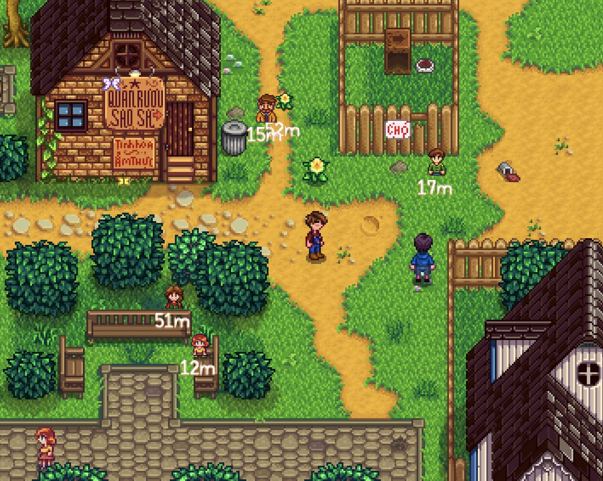
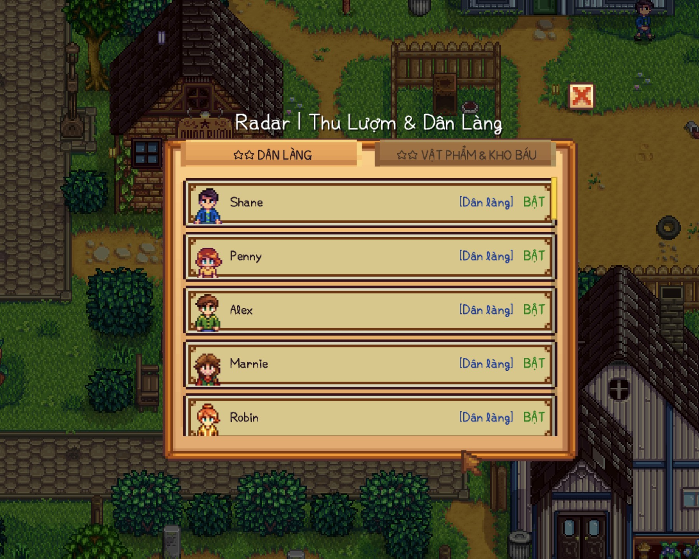
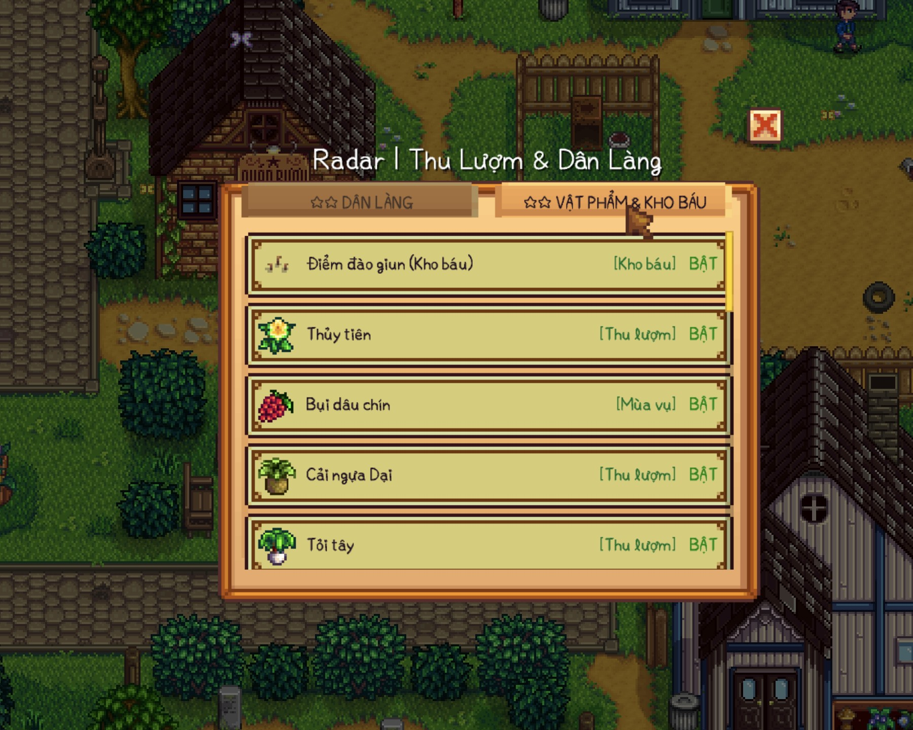

# Forage & NPC Radar for Stardew Valley

Mod radar hỗ trợ dò tìm vật phẩm thu lượm (Forage), điểm đào giun (Artifact Spot), bụi dâu chín theo mùa và theo dõi Dân Làng (NPC) trong thời gian thực cho **Stardew Valley 1.6+** (Tương thích hoàn hảo với cả PC và Android / Cinderbox).

---

## 📸 Hình ảnh Minh họa (Screenshots)

| Vòng tròn Radar & Dẫn đường | Cài đặt tích hợp sẵn trong Game | Menu Quản lý 2 Tab (Dân làng & Vật phẩm) |
| :---: | :---: | :---: |
|  |  |  |

---

## ✨ Tính năng Nổi bật

- 🧭 **Vòng tròn Radar World-Space:**
  - Vòng tròn và icon neo chính xác tuyệt đối quanh nhân vật người chơi trong tọa độ thế giới (không bị lệch tâm khi camera dừng ở góc hay cổng map).
  - Mũi tên chỉ hướng kèm số mét khoảng cách chính xác đến từng mục tiêu theo thời gian thực.
  - **Cơ chế ẩn thông minh (Smart Indicator):** Tự động ẩn icon và khoảng cách khi đối tượng đã đi vào bên trong vòng tròn radar (nằm trong tầm nhìn trước mắt), tránh làm rối mắt và không che tầm nhìn khi thao tác.

- 👥 **Dò tìm Dân Làng (NPC Tracker):**
  - Hiển thị chân dung avatar của tất cả dân làng trên bản đồ với avatar đầy đủ, cân đối.
  - Phân loại rõ ràng với màu sắc riêng biệt giúp dễ dàng tìm kiếm NPC để trả nhiệm vụ hoặc tặng quà.

- 🍄 **Dò tìm Thu Lượm & Kho Báu:**
  - Hỗ trợ tất cả vật phẩm tự nhiên mọc theo mùa.
  - Điểm đào giun (Artifact Spots / Kho báu đào xẻng).
  - Bụi dâu rừng chín theo mùa (Mâm xôi mùa Xuân, Dâu đen mùa Thu).

- ⚙️ **Tích hợp 100% vào Menu Cài đặt (Options) gốc:**
  - Không cần cài Generic Mod Config Menu (GMCM), các nút cấu hình được chèn thẳng vào trang Cài đặt gốc của game.
  - Nút bấm `+` / `-` và Checkbox được tối ưu hóa hitbox cho màn hình cảm ứng di động.
  - Hỗ trợ tùy chỉnh:
    - **Bật / Tắt Radar**.
    - **Bật / Tắt vòng tròn hiển thị**.
    - **Bán kính vòng tròn**: Vừa (160px), Lớn (220px), Rất lớn (280px), Cực đại (350px).
    - **Bán kính quét map**: Gần (20 ô), Vừa (40 ô), Rộng (60 ô), Toàn map (100 ô).
    - **Cỡ Icon & Avatar**: Vừa (2.0x), Lớn (2.6x), Rất lớn (3.2x), Cực đại (4.0x).
    - **Cỡ chữ khoảng cách**: Vừa (1.2x), Lớn (1.5x), Rất lớn (2.0x), Cực đại (2.5x).

- 📋 **Menu Quản lý Danh mục (Radar Menu):**
  - Chia làm **2 Tab riêng biệt**: 👥 **DÂN LÀNG** và 🍄 **VẬT PHẨM & KHO BÁU**.
  - Cho phép Bật / Tắt từng NPC hoặc từng loại vật phẩm cụ thể.
  - Hỗ trợ cuộn cảm ứng Parallax mượt mà với thanh cuộn trực quan.

---

## 🛠️ Yêu cầu & Cài đặt

1. Cài đặt **SMAPI 4.0+** (tương thích Stardew Valley 1.6+).
2. Tải bản release mới nhất của **ForageRadar**.
3. Giải nén thư mục `ForageRadar` vào thư mục `Mods` của game:
   - **PC:** `Stardew Valley/Mods/`
   - **Android / Cinderbox:** `Android/StardewValley/desktop/Mods/`
4. Khởi động game và tận hưởng!

---

## 🔧 Biên dịch từ mã nguồn (Build from source)

Yêu cầu .NET 10.0 SDK:

```bash
git clone https://github.com/dinhmaiphuong2025/Forage-Radar.git
cd Forage-Radar
dotnet build -c Release
```

---

## 📜 Giấy phép (License)

Dự án phát hành dưới giấy phép MIT License. Tự do sử dụng và tùy biến.
